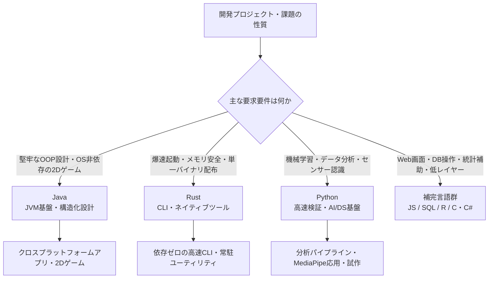

# プログラミング言語の役割分担 / Role Division of Programming Lang

初回更新日: 2026/11/20(金)  
最終更新日: 2026/11/20(金)  

`#技術選定` `#プログラミング言語` `#設計思想` `#Java` `#Rust` `#Python`  
`#technology-selection` `#programming-languages` `#architecture` `#Java` `#Rust` `#Python`


## 1. 概要

本資料では, 筆者が日々のソフトウェア開発, 研究活動, および個人ツール制作において採用しているプログラミング言語の役割分担と技術選定の基準を体系的に整理します. 
単一言語による万能主義を避け, 各言語が持つ設計思想やランタイム特性に応じて開発領域を明確に分離することで, 開発効率, 実行性能, 保守性, および配布容易性のすべてを高水準で両立させることを目的とします. 

特に本資料では, 筆者の技術スタックの中核を成す **Java**, **Rust**, **Python** の3言語について, 言語仕様上の特徴, 具体的な活用領域, メリットの最大化手法, デメリットへの対策を詳細に解説します. 
あわせて, ツール開発におけるプロトタイピングの課題解決戦略と, 補完的に利用する周辺言語の位置づけについても記録します. 


## 2. 技術選定の基本方針と全体アーキテクチャ

### 2.1. 言語役割分担の設計思想

筆者の技術選定における最優先事項は, **「作りたいものの性質と実行環境の制約に対して, 最も無理のない言語を割り当てること」** です. 
すべての領域を一つの言語で無理に実装しようとすると, ランタイムの制約やエコシステムの不足によって設計が歪み, 結果として保守性や開発速度が著しく低下します. 

そのため, 以下の3つの軸を基準として主要3言語の責務を完全に分離しています. 

- **設計の堅牢性とクロスプラットフォーム基盤 (Java):** 純粋なオブジェクト指向設計や構造化されたアーキテクチャが求められるアプリケーション, 特に2Dゲームや長期保守を前提とした基盤開発を担います. 
- **ネイティブ性能と単一バイナリ配布 (Rust):** 起動速度, 実行効率, メモリ安全性, および外部ランタイムに依存しない単一実行ファイルとしての配布が求められるCLIツールや軽量デスクトップツールを担います. 
- **ライブラリ資産と高速検証 (Python):** 機械学習, 統計データ分析, 画像・骨格認識などの豊富な外部エコシステムを即戦力として活用し, アイデアを最短時間で形にする領域を担います. 



> [!NOTE]
> 本資料に記載している各言語の技術仕様やランタイム特性は公式仕様に基づく事実であり, 用途の割り当てや開発手法に関する記述は筆者の実践経験および設計方針に基づくものです. 

### 2.2. 主要3言語の比較一覧

主軸となる3言語の技術的特性と, 筆者の開発環境における位置づけを比較表にまとめます. 

| 比較項目 | Java | Rust | Python |
| :--- | :--- | :--- | :--- |
| **実行方式** | バイトコード + JVM (JITコンパイル) | 事前ネイティブコンパイル (AOT) | インタプリタ (バイトコード逐次実行) |
| **メモリ管理** | ガベージコレクション (GC) | 所有権・借用モデル (コンパイル時検証) | 参照カウント + 世代別GC |
| **型システム** | 静的型付け (名目的型付け) | 静的型付け (強力な型推論・代数的データ型) | 動的型付け (型ヒントによる静的検査可) |
| **起動速度** | やや遅い (JVM起動コストあり) | **極めて高速** (オーバーヘッドほぼゼロ) | 中程度 (インタプリタ初期化コストあり) |
| **ピーク実行性能** | **高速** (JIT最適化後のスループット大) | **極めて高速** (C/C++と同等のネイティブ性能) | 遅い (C/C++拡張ライブラリ呼び出し時は高速) |
| **配布形態** | JARファイル (実行環境にJREが必要) | **単一バイナリ** (依存ゼロで即実行可能) | ソースコード + 仮想環境 (依存管理が必要) |
| **筆者の主戦場** | 2Dゲーム開発, オブジェクト指向設計基盤 | CLIツール, TUI, 軽量ネイティブツール | 機械学習, データ分析, MediaPipeゲーム, 試作 |

### 2.3. 開発フェーズ別の使い分けフロー

新規のアイデアを実装に移す際は, 要件の確定度合いに応じて言語を段階的に使い分けるアプローチを採っています. 

1. **探索・アルゴリズム検証フェーズ:** 仕様が流動的で数理モデルや外部APIの挙動を確かめたい場合は, Pythonを用いて最短時間で動作するプロトタイプを構築します. 
2. **アーキテクチャ構築・ゲームロジック実装フェーズ:** 状態遷移やエンティティ間の関係性が複雑な2Dゲームやシミュレーションでは, Javaを用いてクラス階層やコンポーネント設計を整理しながら実装します. 
3. **実用ツール化・ネイティブ配布フェーズ:** 日常的にターミナルから呼び出すツールや, バックグラウンドで軽量かつ安全に動作させたいユーティリティは, Rustを用いて単一バイナリとして仕上げます. 


## 3. Java：堅牢な設計とクロスプラットフォーム基盤

### 3.1. 言語の特性と技術的強み

Javaは, JVM (Java Virtual Machine) 上で動作する静的型付けのオブジェクト指向プログラミング言語です. 
ソースコードをプラットフォーム非依存のバイトコードへコンパイルし, 各OS向けに実装されたJVM上で実行するアーキテクチャを採用しています. 

- **環境非依存性 (Write Once, Run Anywhere):** OSやCPUアーキテクチャの違いをJVMが吸収するため, ビルド済みのバイトコードをWindows, Linux, macOSなど異なる環境へそのまま持ち込んで動作させることができます. 
- **JIT (Just-In-Time) コンパイラによる動的最適化:** 実行時にJVMがホットスポット (頻繁に実行されるコードパス) をプロファイリングし, 実行環境のCPUに最適化された機械語へ動的にコンパイルします. これにより, 長時間稼働するアプリケーションではC++やRustに迫る高いスループットを発揮します. 
- **成熟した型システムとモダン言語機能:** 厳格なアクセス修飾子やインターフェースによる契約プログラミングに加え, 近年のバージョン (Java 21以降) では `record` による不変データ表現, パターンマッチング, および軽量な仮想スレッド (`Virtual Threads`) が標準導入されており, 記述性と並行処理性能が大きく向上しています. 
- **後方互換性とエコシステム:** 過去のバージョンで書かれた資産が動作し続けることを重視する設計文化があり, ビルドツールやライブラリ群が極めて安定しています. 

### 3.2. 私の活用領域とメリットの活かし方

筆者はJavaを主に **「2Dゲーム開発」** および **「純粋なオブジェクト指向・コンポーネント設計の実践基盤」** として活用しています. 

1. **コード中心の2Dゲーム開発**
   GUIベースの大規模ゲームエンジンに依存せず, ゲームループの制御, 描画パイプライン, 入力処理, 物理演算のすべてをコードベースで把握し制御したい場合にJavaを選択しています. 
   具体的には, クロスプラットフォーム対応のフレームワークである `libGDX` や, OpenGLなどの低レイヤーAPIへ直接アクセスできる `LWJGL` を用いることで, ブラックボックスのない透明性の高いゲーム基盤を構築できます. 

2. **オブジェクト指向およびECS設計の表現力**
   ゲーム開発においては, キャラクター, アイテム, 状態異常, イベント処理といった多様なドメイン概念を破綻なくモデル化する必要があります. 
   Javaの明確なクラス階層, インターフェース分離, ジェネリクスを活用することで, 責務が明確に分離された疎結合な設計を自然に記述できます. また, Entity Component System (ECS) フレームワーク (`Ashley` や `artemis-odb` など) を導入する際も, 型安全性が設計の骨格を支えてくれます. 

3. **マルチOS環境での一貫した動作保証**
   開発環境 (Windows) と検証環境 (Linux) の双方で同一の挙動を担保したい場合, OS固有のシステムコールやビルド設定の違いに悩まされることなく開発を継続できる点は大きな利点です. 

### 3.3. デメリットと運用上の対策

Javaを個人開発やゲーム制作に用いる場合, 以下の技術的デメリットが存在します. 

- **配布時におけるJRE依存の問題**
  Javaアプリケーションを実行するには, エンドユーザーの環境に適切なバージョンのJRE (Java Runtime Environment) がインストールされている必要があります. 一般ユーザーに対してJARファイル単体を配布すると, 実行環境の構築ハードルが高くなります. 
  - **対策:** JDK標準のパッケージングツールである `jpackage` を利用し, アプリケーションの動作に必要な最小限のランタイムモジュール (`jlink` で抽出) を同梱したネイティブインストーラまたは実行形式へ固めることで, ユーザー側の事前環境構築を不要にします. 

- **GC (ガベージコレクション) による一時停止リスク**
  自動メモリ管理は開発効率を高める一方で, メモリ回収処理が走る瞬間にアプリケーション全体が極短時間停止する (Stop-The-World) 現象が発生し得ます. 60fpsや120fpsを維持するゲームループ内では, フレーム落ち (スパイク) の原因となります. 
  - **対策:** ゲームループ内の毎フレーム処理では新規オブジェクトの生成 (`new`) を極力避け, オブジェクトプール (Object Pool) パターンを徹底してヒープ領域への割り当てを抑制します. また, 低遅延なGCアルゴリズム (`ZGC` や `G1GC`) をJVMオプションで明示的に指定します. 

- **小規模ツールに対する冗長性**
  パッケージ構成やクラス定義の作法が厳格であるため, 数十行で完結する使い捨てスクリプトや軽量CLIツールを作る用途では記述量が過剰になります. この領域はRustやPythonへ完全に委譲しています. 

### 3.4. 設計・実装の具体例

Javaを用いた2Dゲーム基盤において, インターフェースと責務分離によってゲームループとエンティティ更新を疎結合に保つ基本構造の例を示します. 

```java
import java.util.ArrayList;
import java.util.List;

// 更新可能なゲーム要素を表す契約インターフェース
public interface Updatable {
    void update(float deltaTime);
}

// 描画可能なゲーム要素を表す契約インターフェース
public interface Renderable {
    void render();
}

// ワールド全体のエンティティライフサイクルを管理するクラス
public class GameWorld {
    private final List<Updatable> updatables = new ArrayList<>();
    private final List<Renderable> renderables = new ArrayList<>();

    public void register(Object entity) {
        if (entity instanceof Updatable u) {
            updatables.add(u);
        }
        if (entity instanceof Renderable r) {
            renderables.add(r);
        }
    }

    public void tick(float deltaTime) {
        for (Updatable entity : updatables) {
            entity.update(deltaTime);
        }
        for (Renderable entity : renderables) {
            entity.render();
        }
    }
}
```


## 4. Rust：安全性と高速性を極めるネイティブツール基盤

### 4.1. 言語の特性と技術的強み

Rustは, メモリ安全性, 並行性, および高い実行パフォーマンスを同時に達成することを目的として設計されたシステムプログラミング言語です. 

- **所有権・借用・ライフタイムによるメモリ安全性の保証:** ガベージコレクション (GC) を持たず, コンパイル時の静的解析 (Borrow Checker) によってダングリングポインタ, 二重解放, データ競合といったメモリ関連のバグを完全に排除します. 
- **ゼロコスト抽象化 (Zero-Cost Abstractions):** イテレータ, ジェネリクス, トレイトといった高度な抽象化機能を使用しても, コンパイル後には手書きの低レイヤーコードと同等の効率的な機械語へ最適化されます. 
- **代数的データ型と網羅性検査:** `enum` と `match` 式を組み合わせることで, 状態遷移やエラーのバリエーションを型レベルで厳密に表現できます. さらに `Option<T>` と `Result<T, E>` により, `null` 参照や未処理の例外による実行時クラッシュを構造的に防ぎます. 
- **単一バイナリ出力とCargoエコシステム:** 標準ビルドツール兼パッケージマネージャである `Cargo` により, 依存解決, ビルド, テスト, ベンチマークが一貫したコマンドで完結し, 外部ランタイム不要の単一実行ファイルを生成できます. 

### 4.2. 私の活用領域とメリットの活かし方

筆者はRustを **「CLIツール (コマンドラインツール)」「TUIアプリケーション」「常駐型軽量デスクトップユーティリティ」** の開発における主力言語として位置づけています. 

1. **起動オーバーヘッドが許されないCLI・TUIツール**
   ターミナル環境から日常的に呼び出すコマンドラインツールにおいては, コマンドを入力してから結果が返るまでのレスポンス速度が体験の質を決定します. 
   Rust製のバイナリはJVMやインタプリタの初期化を必要としないため, 起動時間が数ミリ秒単位に収まり, ストレスのない操作感を実現できます. 引数解析クレートである `clap` を活用することで, サブコマンドやヘルプ生成も含めた堅牢なCLIを型安全に構築しています. 

2. **外部依存を抑えたシンプルかつ疎結合な設計**
   個人のツール開発においては, 過剰な非同期ランタイムや巨大なフレームワークに依存せず, 保守性の高いシンプルな構成を好みます. 
   例えば, バックグラウンド監視や並行処理が必要なデスクトップツールであっても, 重量級の非同期ランタイムを導入するのではなく, Rust標準ライブラリの `std::thread` と `std::sync::mpsc` チャネルのみを組み合わせることで, 依存関係を最小限に抑えた見通しの良いアーキテクチャを実現しています. 

3. **「コンパイルが通れば確実に動く」安心感**
   エラーハンドリングを `Result` 型で明示的に処理する強制力があるため, ファイル入出力の失敗や不正な入力データといったエッジケースを実装段階で網羅できます. 一度ビルドに成功したバイナリは長期にわたって安定稼働し, 運用中の予期せぬクラッシュが極めて少なくなります. 

### 4.3. デメリットと運用上の対策

Rustは非常に強力な言語である反面, 以下の課題が存在します. 

- **所有権・借用チェックによるプロトタイピング速度の低下**
  開発の初期段階から参照のライフタイムや可変借用の排他制御を厳密に満たそうとすると, コンパイルエラーの解消に多くの時間を奪われ, アイデアを素早く試す際の障壁となります. 
  - **対策:** 試作フェーズではメモリ効率の最適化を後回しにし, `.clone()` による値複製を許容してコンパイラを通す「2段階開発アプローチ」を徹底しています. 具体的な高速化手法については第6章で詳述します. 

- **コンパイル時間の長さとバイナリサイズ**
  外部クレートを多数導入すると, 初回ビルドやクリーンビルドに時間がかかり, 試行錯誤のテンポが損なわれます. 
  - **対策:** 不要なクレートの追加を避け, 標準ライブラリで賄える処理は標準機能で実装する方針を採っています. これにより, コンパイル時間の短縮と依存関係のクリーンさを同時に維持しています. 

- **クロスコンパイル時の環境構築コスト**
  異なるOS向けにクロスコンパイルを行う際, リンカの指定やOpenSSLなどのC言語ライブラリ依存が絡むとビルドが失敗しやすくなります. 
  - **対策:** TLS通信が必要な場合は純粋Rust実装の `rustls` を選択し, OSのネイティブCライブラリへの動的リンクを避けることで, ポータビリティを高めています. 

### 4.4. 設計・実装の具体例

Rustにおいて, 外部の非同期ランタイムに依存せず標準ライブラリの `std::thread` と `mpsc` チャネルのみでイベント駆動処理を構成するシンプルな設計例を示します. 

```rust
use std::sync::mpsc;
use std::thread;
use std::time::Duration;

// スレッド間で送受信するメッセージ定義
enum WorkerEvent {
    Processed(usize),
    Completed,
}

fn main() {
    let (tx, rx) = mpsc::channel::<WorkerEvent>();

    // バックグラウンド処理スレッドの起動
    thread::spawn(move || {
        for i in 1..=3 {
            thread::sleep(Duration::from_millis(100));
            if tx.send(WorkerEvent::Processed(i)).is_err() {
                break;
            }
        }
        let _ = tx.send(WorkerEvent::Completed);
    });

    // メインスレッドでのイベント受信ループ
    while let Ok(event) = rx.recv() {
        match event {
            WorkerEvent::Processed(id) => println!("タスク {} を処理しました.", id),
            WorkerEvent::Completed => {
                println!("すべての処理が完了しました.");
                break;
            }
        }
    }
}
```


## 5. Python：データサイエンスと高速プロトタイピングの即戦力

### 5.1. 言語の特性と技術的強み

Pythonは, 高い可読性と簡潔な構文を備えた動的型付けのインタプリタ言語です. 

- **圧倒的な記述効率と低い認知負荷:** インデントによるブロック構造と直感的な構文により, 思考をコードへ変換するまでの時間 (Time-to-Code) が極めて短く, ボイラープレートコードを最小限に抑えられます. 
- **科学技術計算・機械学習エコシステムの事実上の標準:** NumPy, pandas, SciPy, scikit-learn, PyTorchといったライブラリ群が充実しており, データの前処理から深層学習モデルの構築・評価までを一貫したインターフェースで実行できます. 
- **C/C++拡張による高速な計算バックエンド:** Python言語自体の実行速度は遅いものの, 数値計算や画像処理のコア部分はC, C++, CUDAで実装されたネイティブバイナリを呼び出す構造になっているため, 行列演算や推論処理においては非常に高い性能を発揮します. 

### 5.2. 私の活用領域とメリットの活かし方

筆者はPythonを **「データサイエンス・機械学習の研究開発」「MediaPipe等を用いたセンサー連動型ゲーム」「アルゴリズムの高速プロトタイピング」** に特化して活用しています. 

1. **機械学習モデルの構築とデータ分析パイプライン**
   大学でのデータサイエンス研究やシミュレーション課題において, データの可視化, 統計解析, 勾配降下法やニューラルネットワークの実装検証を行う際はPython一択となります. 
   数式やアルゴリズムのアイデアを数十分でコード化し, 実験結果を即座にグラフや数値で確認できるため, 仮説検証のイテレーションを高速に回すことができます. 

2. **MediaPipe等を活用したインタラクティブ・ゲーム開発**
   Webカメラからの映像入力に対して骨格推定やハンドトラッキングを行う `MediaPipe` や画像処理ライブラリ `OpenCV` は, Python向けのバインディングが最も充実しています. 
   物理的なジェスチャーや姿勢を認識して操作する実験的なゲームやインタラクティブコンテンツを制作する場合, 認識パイプラインとゲームロジックを同一言語内でシームレスに接続できるPythonのメリットが最大限に活きます. 

3. **他言語実装前の仕様検証用プロトタイプ**
   複雑なデータ変換ロジックや新しいアイデアの実現可能性 (PoC) を確かめる際, まずはPythonで最小限の動作モデルを作成し, 仕様が固まった段階で必要に応じてRustやJavaへ移植する橋渡し役としても機能しています. 

### 5.3. デメリットと運用上の対策

Pythonを本番ツールや配布用アプリケーションに用いようとすると, 以下の制約が顕在化します. 

- **単一バイナリ配布の困難さと環境依存**
  Pythonスクリプトを他者の環境で動かすには, Pythonインタプリタ本体と仮想環境 (`venv` や `uv` など), および多数のサードパーティパッケージのインストールが必要になります. `PyInstaller` 等で実行ファイル化する手法も存在しますが, ファイルサイズが肥大化しやすく起動も遅くなります. 
  - **対策:** エンドユーザーへ配布するCLIツールや常駐アプリは最初からPythonで作らず, Rustで開発するルールを徹底しています. Pythonは「自分のローカル環境および分析環境で完結する研究・検証・実験用ツール」と割り切ることで, 配布問題を根本から回避しています. 

- **純粋Pythonループの実行速度とGILの制約**
  ネイティブ拡張を呼び出さない純粋なPythonコードで大規模なループ処理や細粒度の並行処理を行うと, インタプリタのオーバーヘッドとGIL (Global Interpreter Lock) の影響で性能が頭打ちになります. 
  - **対策:** 配列演算は必ずNumPyのベクトル化演算へ置き換え, CPUバウンドなネイティブツールが必要な場合はRustへ切り出します. 

- **規模拡大に伴う動的型付けの保守性低下**
  コードベースが数千行規模に膨らむと, 実行してみるまで型不整合に気づけないリスクが高まります. 
  - **対策:** 関数シグネチャには `typing` モジュールによる型アノテーションを付与し, モジュール分割を小さく保つことで可読性と安全性を補完しています. 

### 5.4. 設計・実装の具体例

Pythonの強みである配列演算とデータ処理パイプラインを簡潔に記述する例を示します. 

```python
import numpy as np


def compute_z_scores(values: list[float]) -> np.ndarray:
    """入力数値リストのZスコアをベクトル演算で高速に算出する."""
    arr = np.asarray(values, dtype=np.float64)
    mean = np.mean(arr)
    std = np.std(arr)
    if std == 0.0:
        return np.zeros_like(arr)
    return (arr - mean) / std


if __name__ == "__main__":
    samples = [12.0, 15.0, 14.0, 10.0, 28.0, 13.0]
    scores = compute_z_scores(samples)
    print(f"Z-scores: {np.round(scores, 3)}")
```


## 6. プロトタイピング戦略とツール開発の課題解決

### 6.1. ツール試作におけるジレンマ

開発実践において直面した重要な課題の一つが, **「ツール開発におけるプロトタイピング速度と実行・配布品質の両立」** です. 

- JavaやPythonを用いれば, アイデアを即座にコードへ落とし込むことができ, 初期の開発スピードは非常に高速です. しかし, 出来上がった成果物を実用的なCLIツールやデスクトップツールとして日常利用・配布しようとすると, JREの同梱や仮想環境の依存といったランタイムの重さが足かせになります. 
- 一方で, 最初からRustを用いてツールを開発すると, 完成品は単一バイナリかつ爆速になりますが, 開発初期の試行錯誤段階で所有権や借用チェッカーとの調整に時間を要し, プロトタイピングの初速が落ちるというジレンマが生じます. 

### 6.2. Goを採用せずRustを主軸とする判断基準

上記の課題を解決する選択肢として, シンプルな言語仕様とGCを持ちつつ単一バイナリを高速に生成できる **Go** の導入も検討対象となります. 
しかし, 以下の4つの理由から, 現時点ではGoを新たに導入せず, **Rustを主軸として習熟度を引き上げる戦略** を選択しています. 

1. **技術スタックの肥大化防止:** すでにJava, Rust, Pythonの3本柱で役割が綺麗に完結しており, ここに新たな主要言語を追加すると学習時間とメンテナンス対象が分散します. 
2. **Rustの学習機会の保護:** ツール開発の領域をGoへ譲ってしまうと, 実践を通じてRustを書く機会が失われ, いつまでもRustの所有権モデルに習熟できない悪循環に陥ります. 
3. **極限の高負荷処理における優位性:** 大量ファイルの高速走査やゼロオーバーヘッドが要求される高負荷処理においては, GCを持つGoよりもRustの方が本質的な性能ポテンシャルで優位に立ちます. 
4. **最終到達点の高さ:** Rustの記述速度そのものを引き上げることができれば, 「開発も爆速・実行も爆速・単一バイナリ配布」という理想的な開発体験を単一言語で完結できます. 

> [!IMPORTANT]
> 言語を増やして一時的な書きやすさを得るよりも, すでに選定したRustの記述スキルを磨き込み, 手足のように扱える状態を目指すことが長期的な技術資産として最も合理的であると判断しています. 

### 6.3. Rustでのプロトタイピングを高速化する実践手法

Rustで試作を行う際の開発速度低下を防ぐため, 以下の3つの実践ルールを運用しています. 

- **試作フェーズにおける `.clone()` の積極的許容**
  初期実装の段階からライフタイム注釈や複雑な参照構造で悩むことを禁止し, 借用エラーが発生した箇所は迷わず `.clone()` で値を複製してコンパイルを通します. まずは動作するプロトタイプを最短で完成させ, 実際に動かした後にボトルネックとなる箇所だけをゼロコピーな参照設計へリファクタリングします. 

- **「動くベタ書き」から「コンパイラ支援リファクタリング」への順序徹底**
  オブジェクト指向言語の感覚で最初から完璧なモジュール分割やトレイト階層を設計しようとすると, 仕様変更時に借用関係が破綻しやすくなります. Rustでは最初に `main.rs` へ泥臭く処理を書き下して動作確認を行い, 仕様が固まってから関数やモジュールへ切り出す手順を採ります. Rustの強力な型システムがリファクタリング時の不整合をすべて検出してくれるため, 後からの構造整理は極めて安全に実行できます. 

- **最小構成テンプレートの活用**
  新しいツールを立ち上げるたびに `Cargo.toml` の設定やエラー型のボイラープレートを一から書く手間を省くため, 最小限の依存構成を備えたプロジェクトひな形を用意し, 思考が冷めないうちに本題のロジック実装へ入れる環境を整えています. 


## 7. 補完言語および将来候補の位置づけ

### 7.1. サブ言語の役割一覧

主要3言語 (Java, Rust, Python) ではカバーしきれない固有の実行環境や, 特定ドメインに特化した作業については, 以下の言語を補完的に位置づけています. 

| 言語 | 役割分類 | 主な用途・位置づけ |
| :--- | :--- | :--- |
| **JavaScript** | Webフロントエンド専任 | ブラウザ上で動作するUI制御, インタラクティブなWebページの構築 (HTML/CSSと連携) |
| **SQL** | データ操作基盤 | リレーショナルデータベースからのデータ抽出, 集計, スキーマ定義 (言語横断の共通インフラ) |
| **R** | 統計解析補助 | 統計検定やデータ可視化を簡易に実行するためのサブ分析ツール |
| **C / C#** | 低レイヤー・本格3D予備 | ハードウェア近傍の低レイヤー制御 (C), および本格3Dゲームエンジン (Unity) 使用時の選択肢 (C#) |
| **Go** | 将来的な補完候補 | 非同期ネットワーク通信や軽量Web APIサーバーが主目的となった場合の検討対象 (現時点では未導入) |

### 7.2. 各補完言語の運用方針

- **JavaScript:** Webブラウザというプラットフォーム上で動く限り代替が効かないため, 「Web画面担当」として明確に独立させています. 
- **SQL:** アプリケーション言語とは独立した「データへの問い合わせ言語」であり, Pythonでのデータ分析や業務システム開発の双方で必須となる基礎インフラとして扱います. 
- **R:** データサイエンス領域ではPythonと役割が重複しますが, 統計手法の確認や単発のグラフ描画を手早く行いたい場面のサブツールとして保持しています. 
- **C / C#:** 普段の開発では主要3言語を優先しつつ, OSカーネルや組込みに近い低レイヤー理解にはCを, 将来的に本格的な3Dゲーム制作へ踏み込む際にはUnityと組み合わせたC#を選択できるよう視野に入れています. 
- **Go:** 現時点では学習リソースをRustへ集中させるため意図的に導入を見送っています. 将来, 複雑なネットワーク通信やWeb APIサーバーを軽量バイナリで量産する要件が生じた場合に限り, 導入を再検討します. 


## 8. 注意事項

- 本資料における言語の役割分担は, 筆者の現在の開発環境および個人開発・学術研究の規模を前提とした設計指針です. チーム開発や企業システムにおいては, 組織の標準技術スタックや既存資産の保守体制を優先する必要があります. 
- 各言語のランタイム性能やエコシステムの状況はアップデートによって変化するため, 新規プロジェクト開始時には対象バージョンの最新仕様を確認してください. 


## 9. 参考

[Oracle, The Java Language Environment(2026/11/20閲覧)](https://docs.oracle.com/en/java/)  
[The Rust Foundation, The Rust Programming Language(2026/11/20閲覧)](https://doc.rust-lang.org/book/)  
[Python Software Foundation, Python 3 Documentation(2026/11/20閲覧)](https://docs.python.org/3/)  
[libGDX, libGDX Documentation(2026/11/20閲覧)](https://libgdx.com/wiki/)  
[Google AI for Developers, MediaPipe Solutions Guide(2026/11/20閲覧)](https://ai.google.dev/edge/mediapipe/solutions/guide)
